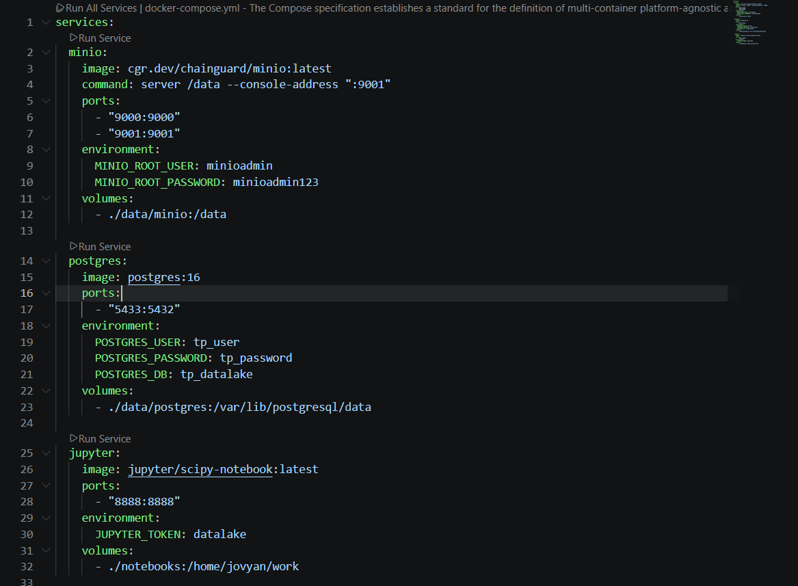
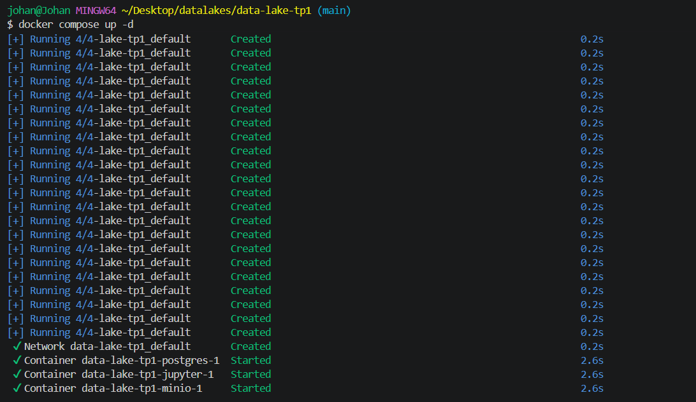
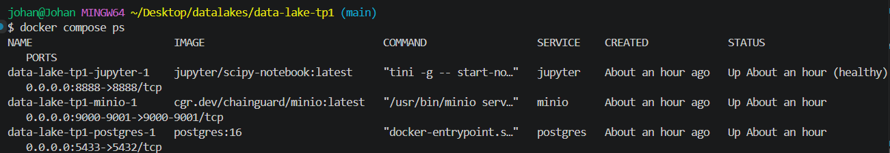
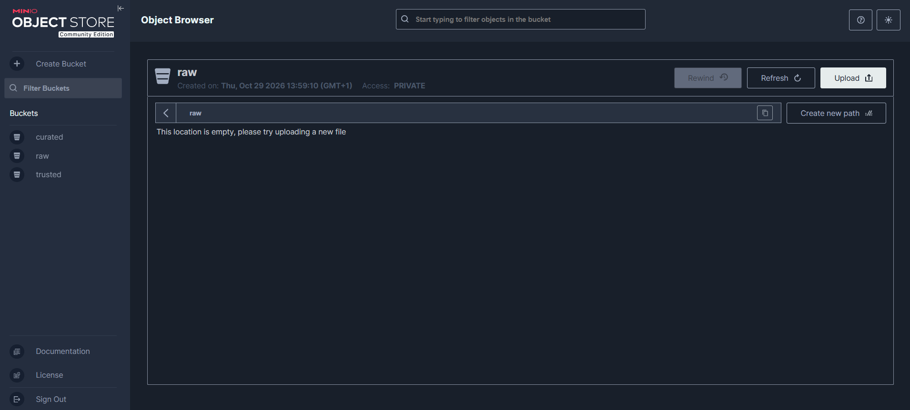
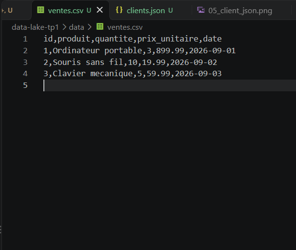
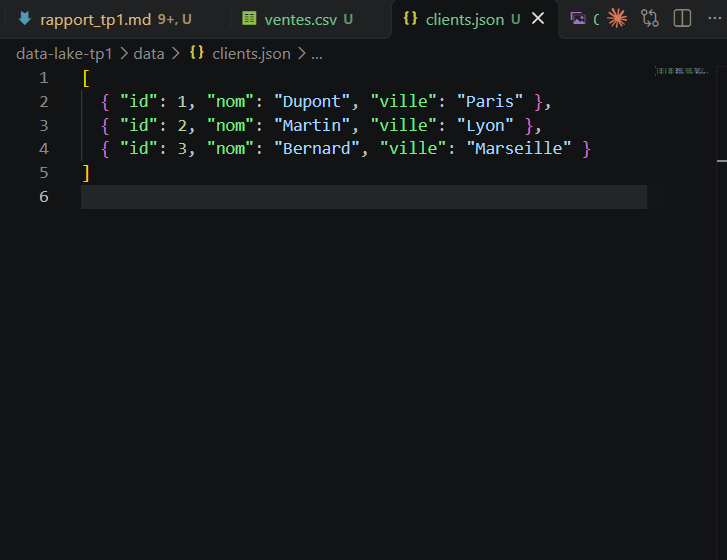
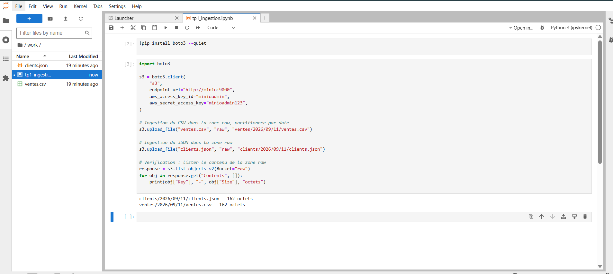
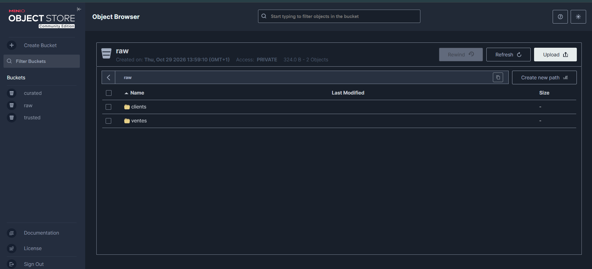
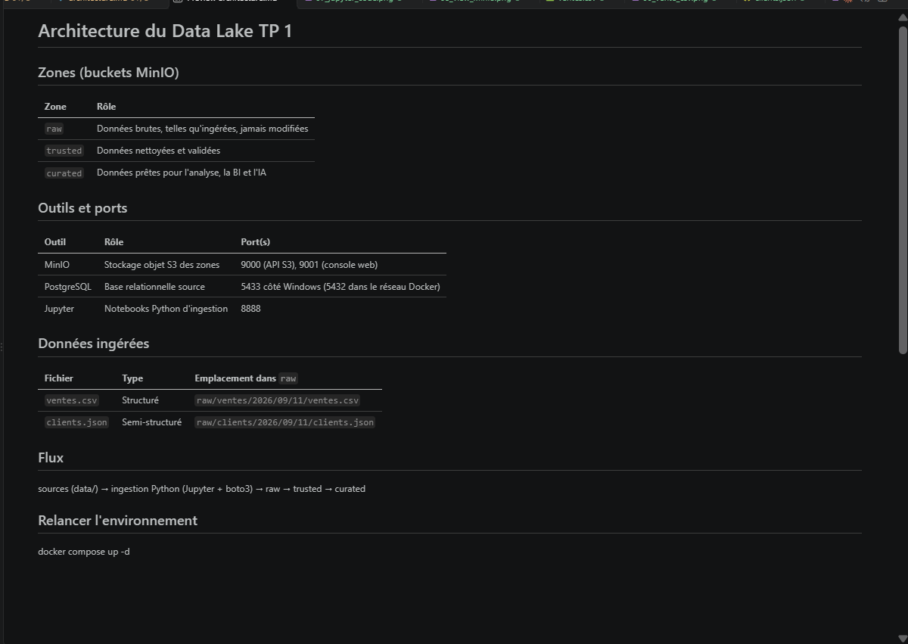
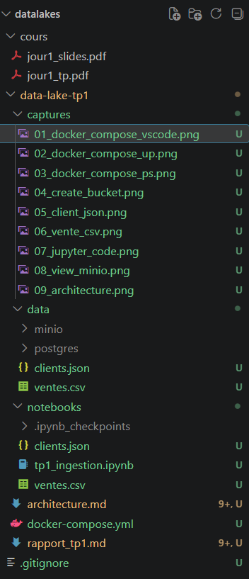

# TP 1 - Construire le squelette du Data Lake

**Module :** Data Lakes & Data Integration

**Étudiant :** Johan Gourmand - 29/10/2026

**Dépôt GitHub (public) :** <https://github.com/Joepok77/datalakes>

> L'ensemble du projet (docker-compose, données, notebook, architecture et ce rapport) est consultable sur ce dépôt public, dans le dossier `data-lake-tp1/`.

## Étape 1 - Arborescence du projet

Création du dossier `data-lake-tp1` avec deux sous-dossiers :

- `data/` : fichiers sources, et stockage persistant de MinIO et PostgreSQL ;
- `notebooks/` : notebooks Jupyter, partagés avec le conteneur.

*L'arborescence finale est présentée en fin de rapport.*

## Étape 2 - Écriture du `docker-compose.yml`

Le fichier décrit toute la stack en un seul endroit : **MinIO** (stockage S3 des zones), **PostgreSQL** (base source) et **Jupyter** (notebooks Python). Un seul `docker compose up` suffit ensuite pour tout démarrer.



**Deux adaptations par rapport au sujet :**

| Ligne modifiée | Pourquoi |
|---|---|
| `image: cgr.dev/chainguard/minio:latest` | L'image `minio/minio` du sujet n'existe plus sur Docker Hub (voir étape 3). |
| `"5433:5432"` pour PostgreSQL | Le port 5432 est déjà pris par un PostgreSQL installé sur le poste. Seul le port côté Windows change ; dans le réseau Docker, PostgreSQL reste sur `postgres:5432`. |

## Étape 3 - Lancement de la stack

```bash
docker compose up -d
```

### Problème rencontré

Le premier lancement échoue sur MinIO :

```text
Error response from daemon: pull access denied for minio/minio,
repository does not exist or may require 'docker login'
```

- **Diagnostic :** `postgres:16` se télécharge normalement, donc Docker Hub fonctionne. Seule l'image MinIO pose problème : l'éditeur l'a retirée de Docker Hub en 2026, et le miroir `quay.io/minio/minio` exige maintenant un compte. Un `docker login` ne change rien.
- **Solution :** passage à `cgr.dev/chainguard/minio`, le même logiciel MinIO compilé par Chainguard et accessible sans compte. Il a été testé avant d'être adopté.

### Résultat

Les trois conteneurs démarrent :



Vérification avec `docker compose ps` : les trois services sont `Up`.



## Étape 4 - Création des zones (buckets) dans MinIO

Chaque zone du Data Lake correspond à un bucket MinIO :

| Bucket | Rôle |
|---|---|
| `raw` | Données brutes, conservées telles qu'elles arrivent |
| `trusted` | Données nettoyées et validées |
| `curated` | Données prêtes pour l'analyse, la BI et l'IA |

Les trois buckets ont été créés depuis l'interface web MinIO (<http://localhost:9001>, identifiants `minioadmin` / `minioadmin123`), avec le bouton **Create Bucket**.

> Identifiants volontairement en clair : acceptable en local pour la formation, jamais en production.



## Étape 5 - Préparation du jeu de données

Conformément au TP, on prépare deux fichiers d'exemple dans `data/`. Chacun représente une famille de données que le Data Lake doit accueillir :

- **`ventes.csv`** : données **structurées**, avec des lignes et des colonnes fixes (id, produit, quantité, prix unitaire, date). C'est le format typique d'un export de base relationnelle.
- **`clients.json`** : données **semi-structurées**, organisées en objets clé/valeur (id, nom, ville). C'est le format typique d'une réponse d'API.





## Étape 6 - Ingestion dans la zone `raw`

Cette étape correspond à la brique **Ingestion** de l'architecture : récupérer les données sources et les déposer dans le Data Lake. Elle est réalisée en Python, depuis un notebook Jupyter, avec la bibliothèque `boto3`.

Les fichiers sont d'abord copiés dans `notebooks/`, seul dossier visible depuis le conteneur Jupyter :

```bash
cp data/ventes.csv data/clients.json notebooks/
```

Le notebook installe ensuite `boto3`, se connecte à MinIO, envoie les deux fichiers dans le bucket `raw` et liste le contenu du bucket pour vérification :



**Points clés du code :**

- **`endpoint_url="http://minio:9000"`** : le notebook tourne dans un conteneur Docker. Il joint donc MinIO par son nom de service, `minio`, et non par `localhost`.
- **`boto3`** est le client officiel d'Amazon S3. MinIO parle la même API S3 : le même code fonctionnerait sur AWS S3 en changeant seulement l'adresse et les identifiants.
- **`ventes/2026/09/11/ventes.csv`** : les fichiers sont rangés par source puis par date. C'est le **partitionnement** : un traitement qui cherche les ventes d'un jour donné ne lit que le dossier de ce jour, et pas tout le Data Lake.

### Vérification dans MinIO

Les deux fichiers apparaissent dans la console MinIO, dans le bucket `raw` (2 objets, 324 octets au total), sous les dossiers `clients/` et `ventes/` :



**Intérêt de retrouver les données dans MinIO :**

- **Centralisation** : les données ne sont plus dispersées sur un poste, elles sont dans un stockage unique, accessible à tous les outils (Jupyter aujourd'hui, Spark au jour 3).
- **Séparation stockage / calcul** : Jupyter fait le calcul et MinIO stocke. On peut arrêter ou remplacer le notebook sans perdre les données.
- **Données brutes conservées** : la zone `raw` garde les fichiers tels qu'ils sont arrivés, sans modification. Si un traitement ultérieur est faux, on peut toujours repartir de l'original. La structure des données sera définie au moment de la lecture (*schema-on-read*).

## Étape 7 - Documentation de l'architecture

Création du fichier `architecture.md`, livrable demandé par le TP, à la racine du projet. Il résume les trois zones et leur rôle, les outils et leurs ports d'accès, et les deux fichiers ingérés avec leur emplacement dans `raw`.



### Schéma de l'architecture

```text
  SOURCES : ventes.csv, clients.json  (PostgreSQL : TP suivants)
                 |
                 v
  INGESTION : Jupyter :8888  (Python + boto3)
                 |   envoi S3 vers http://minio:9000
                 v
  ┌───────────── STOCKAGE - MinIO :9000 / :9001 ─────────────┐
  │                                                          │
  │   raw  ──nettoyage──>  trusted  ──agrégation──>  curated │
  │ (2 fichiers)          (vide)                    (vide)   │
  └──────────────────────────────────────────────────────────┘
                 |
                 v
  ACCÈS : notebooks, BI, IA  (TP suivants)
```

On y retrouve les quatre briques vues en cours (ingestion, stockage, traitement, accès). Pour l'instant, seule la zone `raw` est alimentée : les étapes de nettoyage et d'agrégation viendront dans les prochains TP.

## Arborescence finale du projet

La structure suit celle demandée par le TP (`data-lake-tp1/` avec `data/`, `notebooks/`, `docker-compose.yml` et `architecture.md`), avec deux ajouts pour le rendu.



| Élément | Contenu |
|---|---|
| `cours/` | Slides et sujet du TP, gardés à côté du projet pour travailler. Exclus du dépôt Git via `.gitignore`. |
| `data-lake-tp1/captures/` | Captures d'écran utilisées dans ce rapport. |
| `data-lake-tp1/data/` | Fichiers sources `ventes.csv` et `clients.json`. |
| `data-lake-tp1/data/minio/` | Stockage réel de MinIO : buckets et objets. Exclu de Git. |
| `data-lake-tp1/data/postgres/` | Fichiers internes de la base PostgreSQL. Exclu de Git. |
| `data-lake-tp1/notebooks/` | Notebook `tp1_ingestion.ipynb` et copies des fichiers à ingérer. |
| `docker-compose.yml` | Configuration de la stack Docker : MinIO, PostgreSQL, Jupyter. |
| `architecture.md` | Documentation de l'architecture (livrable de l'étape 7). |
| `rapport_tp1.md` | Le présent rapport. |
| `.gitignore` | Liste des éléments exclus du dépôt Git. |

**Pourquoi `minio/` et `postgres/` mais pas de dossier `jupyter/` dans `data/` ?** Ces dossiers sont les **volumes** déclarés dans `docker-compose.yml` : ils sont créés automatiquement au premier lancement. Les données de MinIO et de PostgreSQL survivent ainsi à l'arrêt ou à la suppression des conteneurs. Jupyter, lui, ne stocke pas de données : son volume est le dossier `notebooks/` (monté en `/home/jovyan/work`), qui existe déjà dans le projet. Il n'a donc pas besoin d'un dossier dans `data/`.

## Conclusion

Le squelette du Data Lake est opérationnel. L'environnement complet se relance en une commande, et une première ingestion a été vérifiée de bout en bout : du fichier source jusqu'à la zone `raw`.

Le TP a aussi montré l'intérêt de s'appuyer sur un standard. Quand l'image MinIO a disparu, il a suffi d'en changer : le code d'ingestion, basé sur l'API S3, n'a pas bougé.

**Limites actuelles :** les zones `trusted` et `curated` sont encore vides, PostgreSQL est démarré mais pas encore exploité, et les identifiants sont en clair.

**Pour le TP 2 :** relancer l'environnement avec `docker compose up -d` depuis `data-lake-tp1/`.
