# TP 2 - Pipeline d'ingestion multi-sources

**Module :** Data Lakes & Data Integration

**Étudiant :** Johan Gourmand - 30/10/2026

**Dépôt GitHub (public) :** <https://github.com/Joepok77/datalakes>

> Le TP 2 repart de l'environnement du TP 1 : même dossier `data-lake-tp1/`, même stack Docker, mêmes buckets MinIO. Le dossier `notebooks/` est rangé par TP (`tp1/`, `tp2/`) : chaque notebook s'exécute dans son dossier, avec ses fichiers.

## Étape 1 - Chargement de données de test dans PostgreSQL

PostgreSQL joue le rôle de la base opérationnelle d'une application. On y crée une table `commandes` avec 4 lignes : c'est la première des trois sources du pipeline.

Le script SQL est écrit dans `data/commandes.sql` :

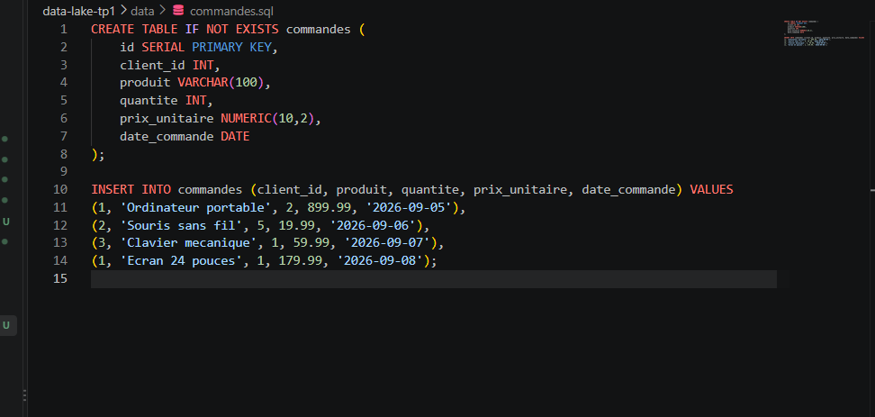

- **`CREATE TABLE IF NOT EXISTS`** crée la table seulement si elle n'existe pas encore : relancer le script ne provoque pas d'erreur.
- **`id SERIAL PRIMARY KEY`** : identifiant unique, numéroté automatiquement par PostgreSQL.
- **Types adaptés à chaque colonne** : `NUMERIC(10,2)` pour un prix exact à 2 décimales, `DATE` pour la date de commande, `VARCHAR(100)` pour le nom du produit. Le schéma est imposé à l'écriture, contrairement au Data Lake.
- **`INSERT INTO ... VALUES`** ajoute les 4 commandes. `client_id` reprend les identifiants des clients du TP 1, ce qui permettra plus tard de croiser les sources.

Il est exécuté directement dans le conteneur avec `docker compose exec`, sans installer de client PostgreSQL sur Windows. Un `SELECT COUNT(*)` confirme ensuite les 4 lignes :

```powershell
Get-Content "data\commandes.sql" -Raw | docker compose exec -T postgres psql -U tp_user -d tp_datalake
"SELECT COUNT(*) FROM commandes;" | docker compose exec -T postgres psql -U tp_user -d tp_datalake
```

- **`Get-Content ... -Raw |`** : lit le fichier en un seul bloc et l'envoie à la commande suivante.
- **`docker compose exec -T postgres`** : exécute une commande dans le conteneur du service `postgres` ; `-T` permet de lui transmettre ce flux.
- **`psql -U tp_user -d tp_datalake`** : client PostgreSQL, il se connecte avec l'utilisateur et la base définis dans le `docker-compose.yml`, puis exécute le SQL reçu.

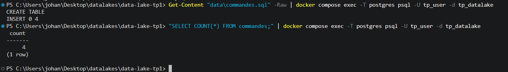

## Étape 2 - Préparation du carnet de bord du pipeline

Chaque extraction du pipeline doit laisser une trace. On crée donc un **journal d'ingestion**, `notebooks/tp2/journal_ingestion.csv`, qui ne contient au départ que son en-tête :

```csv
horodatage,source,nb_lignes,fichier
```

Dans un nouveau notebook `pipeline_ingestion.ipynb`, la première cellule installe les bibliothèques nécessaires, et la deuxième prépare les outils communs à toutes les extractions :

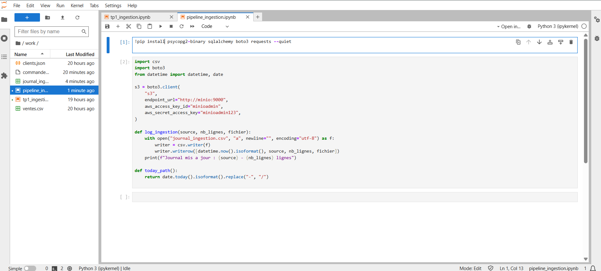

- **`pip install`** : `psycopg2-binary` et `sqlalchemy` pour PostgreSQL, `boto3` pour MinIO, `requests` pour l'API REST.
- **`s3`** : le client MinIO, identique à celui du TP 1.
- **`log_ingestion()`** ajoute une ligne au journal à chaque extraction : date et heure, source, nombre de lignes, emplacement dans `raw`. On peut ainsi savoir à tout moment ce qui est entré dans le Data Lake, et quand.
- **`today_path()`** transforme la date du jour en chemin (`2026/10/30`) : chaque exécution est rangée automatiquement dans sa partition de date.

## Étape 3 - Extraction depuis PostgreSQL

Une nouvelle cellule lit la table `commandes` et la dépose telle quelle dans la zone `raw`. La cellule confirme les 4 lignes extraites :

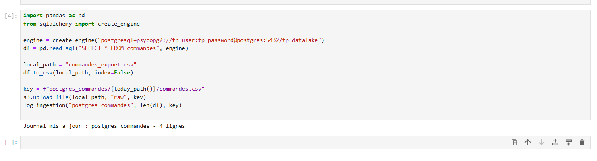

- **`create_engine(...)`** ouvre la connexion à PostgreSQL. L'hôte est `postgres:5432`, le nom du service Docker, car Jupyter tourne dans le réseau Docker ; `localhost:5433` ne sert que depuis Windows.
- **`pd.read_sql`** exécute la requête et récupère la table dans un DataFrame pandas.
- **`to_csv`** écrit d'abord un fichier local : en cas d'échec de l'envoi, la donnée extraite n'est pas perdue et l'envoi peut être relancé.
- **`upload_file`** envoie le fichier dans `raw` sous la clé `postgres_commandes/2026/10/30/commandes.csv`, partitionnée par source et par date.
- **`log_ingestion`** ajoute la première ligne au journal : source, 4 lignes, chemin du fichier.

Le fichier apparaît bien dans la console MinIO, au chemin attendu :

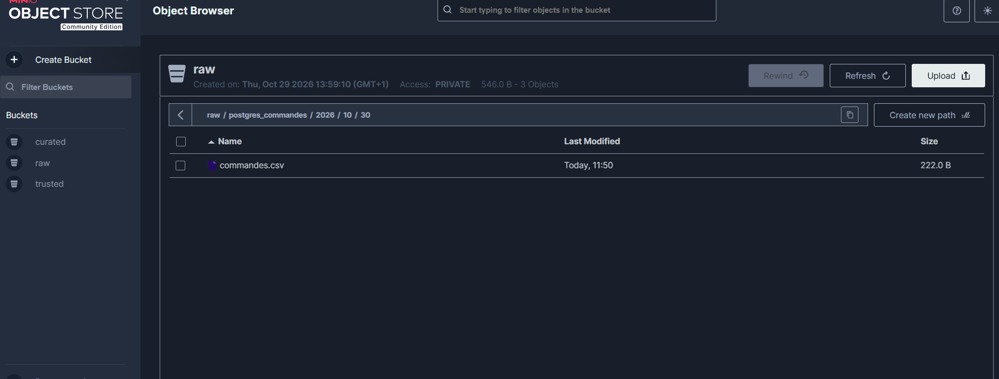

## Étape 4 - Extraction depuis une API REST

La deuxième source est une API publique, jsonplaceholder, qui simule un partenaire externe. Elle renvoie une liste de 10 utilisateurs au format JSON :

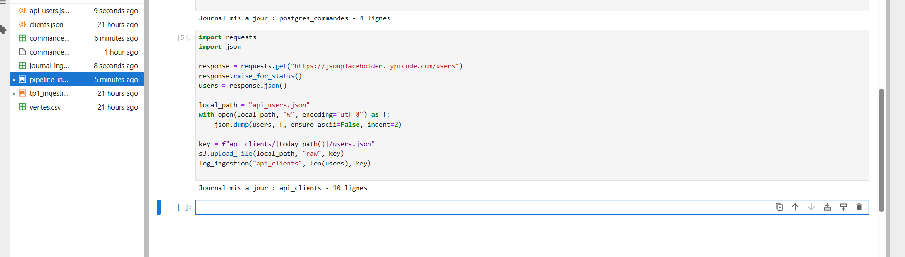

- **`requests.get`** interroge l'API ; **`raise_for_status()`** arrête la cellule si la réponse est une erreur (404, 500…), pour ne pas envoyer une réponse vide ou invalide dans le Data Lake.
- **`response.json()`** convertit la réponse en liste Python.
- **`json.dump`** enregistre cette réponse brute dans `api_users.json`, sans la modifier. Comme à l'étape 3, la copie locale permet de rejouer l'envoi sans réinterroger l'API.
- **`upload_file`** et **`log_ingestion`** fonctionnent comme pour PostgreSQL : le fichier va dans `api_clients/2026/10/30/users.json`, et le journal compte 10 utilisateurs.

Le fichier `api_users.json` est créé automatiquement par la cellule. Chaque utilisateur contient des objets imbriqués (`address`, qui contient lui-même `geo`, et `company`) : c'est une donnée semi-structurée, qui ne rentre pas telle quelle dans une table SQL.

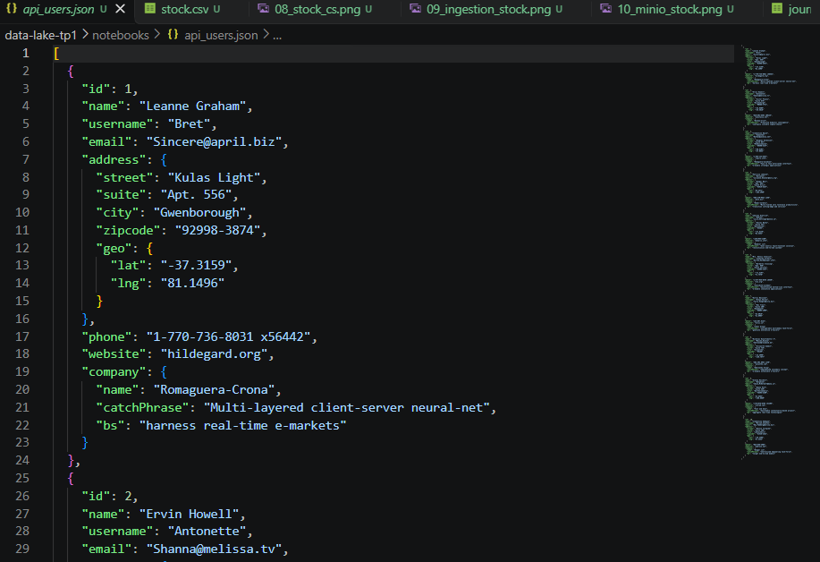

Le fichier est donc gardé en JSON dans `raw`, sans conversion : le Data Lake accueille chaque source dans son format d'origine, et la mise à plat viendra plus tard, dans la zone `trusted`.

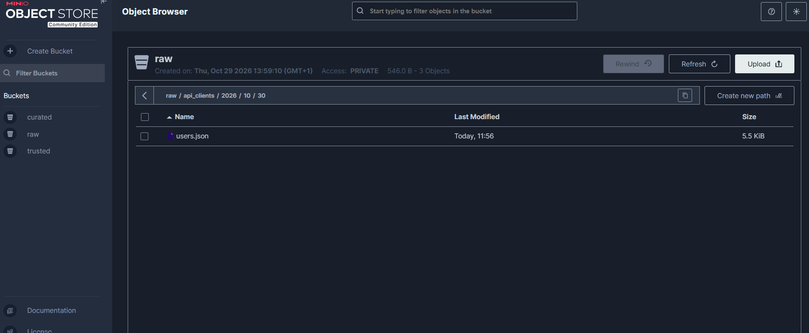

## Étape 5 - Ingestion de fichiers plats supplémentaires

La troisième source est un fichier plat : un export CSV de stock, comme s'il était envoyé par un service tiers. Il est créé dans VS Code, dans le dossier `notebooks/tp2/`, pour être lisible depuis le notebook :

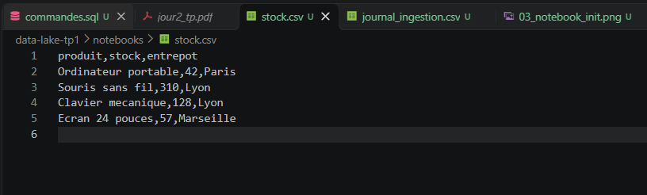

Une nouvelle cellule l'envoie dans la zone `raw` :

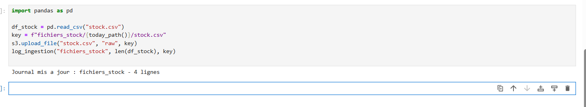

- **`pd.read_csv`** lit le fichier uniquement pour compter ses lignes (4 produits), afin d'alimenter le journal.
- **`upload_file`** envoie le fichier d'origine, et non le DataFrame : la zone `raw` garde la donnée exactement telle qu'elle a été reçue.
- La clé `fichiers_stock/2026/10/30/stock.csv` suit le même découpage par source et par date que les deux autres extractions.

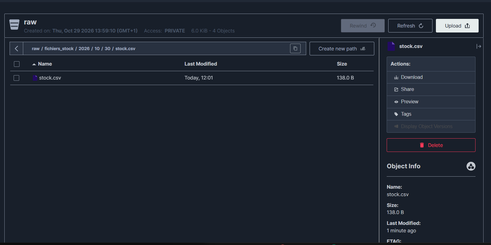

## Étape 6 - Vérification de l'ensemble du pipeline

On liste d'abord tout le contenu de la zone `raw` directement depuis le notebook :

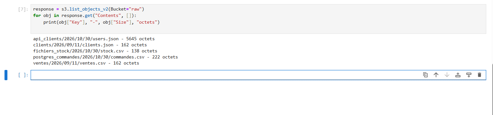

- **`list_objects_v2`** demande à MinIO la liste des objets du bucket ; la boucle affiche la clé et la taille de chacun.
- Les trois sources du TP 2 sont présentes (`postgres_commandes/`, `api_clients/`, `fichiers_stock/`), à côté des fichiers du TP 1 (`clients/`, `ventes/`). Toutes suivent le même découpage `source/année/mois/jour/`.

On affiche ensuite le journal d'ingestion sous forme de tableau avec `pd.read_csv("journal_ingestion.csv")` :

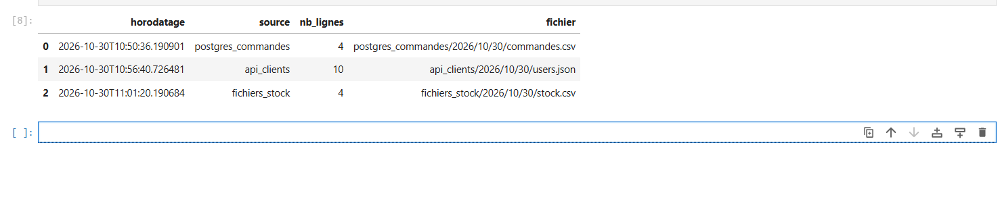

Le journal contient exactement trois lignes, une par extraction, avec un nombre de lignes cohérent : 4 commandes, 10 utilisateurs, 4 produits en stock. L'horodatage est en heure UTC, celle du conteneur Jupyter.

## Étape 7 - Pour aller plus loin : un script exécutable en une commande

Les trois extractions du notebook sont regroupées dans un seul script, `notebooks/tp2/ingestion_pipeline.py` :

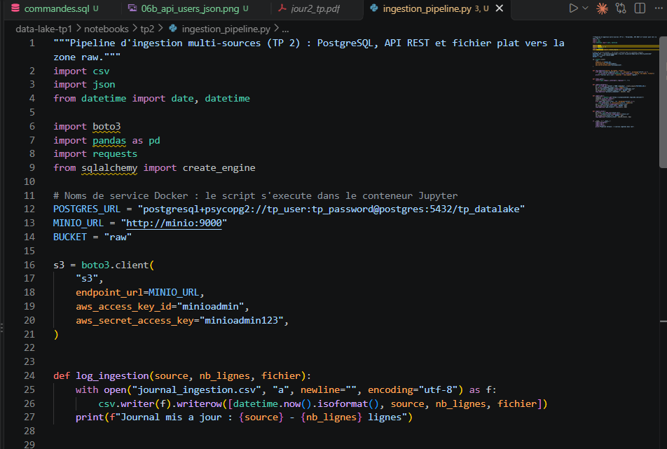

- Le code est celui des cellules du notebook, rangé en **fonctions** : `ingest_postgres()`, `ingest_api()` et `ingest_stock()`, plus les outils communs `log_ingestion()` et `today_path()`.
- Le bloc **`if __name__ == "__main__":`** lance les trois extractions l'une après l'autre quand le fichier est exécuté.
- Les adresses de connexion sont regroupées en haut du fichier (`POSTGRES_URL`, `MINIO_URL`) : un seul endroit à modifier si l'environnement change.

Le script est lancé dans le conteneur Jupyter, donc dans le réseau Docker : les noms de service `postgres` et `minio` restent valables, sans rien installer sur Windows. Lancé depuis Windows, il faudrait utiliser `localhost:5433` pour PostgreSQL et `localhost:9000` pour MinIO.

```powershell
docker compose exec -w /home/jovyan/work/tp2 jupyter python ingestion_pipeline.py
```

- **`exec jupyter`** lance la commande dans le conteneur Jupyter.
- **`-w /home/jovyan/work/tp2`** s'y place dans le dossier du TP 2, où se trouvent `stock.csv` et le journal.

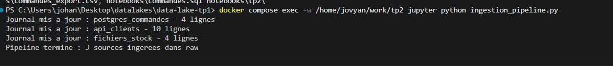

Le pipeline est donc rejouable. Une nouvelle exécution le même jour remplace les fichiers du jour dans `raw`, puisqu'ils ont la même clé, sans créer de doublon. Le journal, lui, garde la trace de chaque passage : il compte désormais six lignes, trois pour le notebook et trois pour le script.

## Conclusion

Le pipeline alimente la zone `raw` à partir de trois familles de sources : une base relationnelle, une API REST et un fichier plat. Chaque source y est déposée dans son format d'origine et rangée par source et par date. Chaque exécution est tracée dans le journal d'ingestion. Le pipeline peut être relancé chaque jour, depuis le notebook ou en une commande grâce au script : les nouveaux fichiers iront automatiquement dans la partition du jour. Cette zone `raw` sert de point de départ au TP 3 (transformation et qualité des données).
