# TP 3 - Transformer, contrôler, sécuriser et mesurer

**Module :** Data Lakes & Data Integration

**Étudiant :** Johan Gourmand - 30/10/2026 et 19/11/2026

**Dépôt GitHub (public) :** <https://github.com/Joepok77/datalakes>

> Le TP 3 repart de l'environnement des TP 1 et 2 (même stack Docker, zone `raw` alimentée au TP 2). Le dossier de projet s'appelle désormais `data-lake/` (ex-`data-lake-tp1/`, renommé car il sert à tous les TP). Les fichiers du TP sont dans `notebooks/tp3/`. J'ai commencé le TP le 30/10 et je l'ai repris le 19/11 : les traitements relancés à la reprise sont datés du 19/11.

## Étape 1 - Préparation du notebook et des fonctions utilitaires

Le but du TP est de faire passer les données de `raw` à `trusted` (données nettoyées et vérifiées), puis à `curated` (données prêtes à être analysées). Tout le traitement est fait dans un nouveau notebook, `tp3_transformation.ipynb`.

En plus de pandas et boto3, il faut installer `pyarrow`, qui permet de lire et d'écrire du Parquet, le format utilisé dans `trusted` et `curated`. La deuxième cellule regroupe des fonctions qui reviennent tout au long du TP, pour ne pas réécrire le même code à chaque étape :

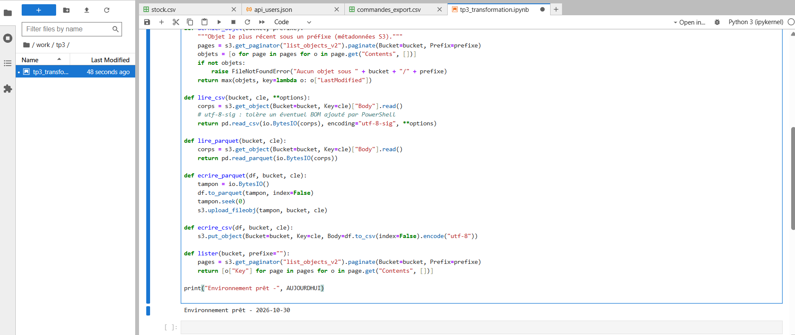

Les fonctions de lecture et d'écriture travaillent directement en mémoire avec MinIO, sans passer par des fichiers sur le disque. `dernier_objet()` retrouve tout seul le fichier le plus récent d'une source : le code fonctionne quelle que soit la date de dépôt. `log_transfo()` garde une trace de chaque transformation, comme le journal d'ingestion du TP 2.

La troisième cellule vérifie que les buckets et les trois sources du TP 2 sont bien là. Cela évite de lancer tout le traitement pour découvrir une erreur à la fin.

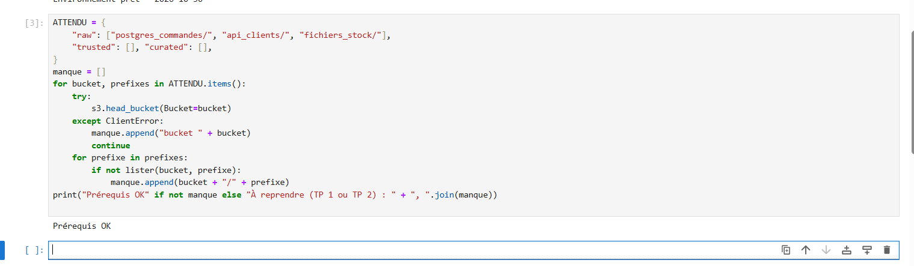

## Étape 2 - Ajout d'un fichier volontairement imparfait dans raw

Jusqu'ici, toutes les données étaient propres, ce qui n'arrive presque jamais en entreprise. Le TP simule donc un partenaire qui envoie un export de commandes avec des erreurs : espaces en trop, virgule à la place du point, ligne en double, client ou prix manquant, quantité négative, date au format français et client qui n'existe pas.

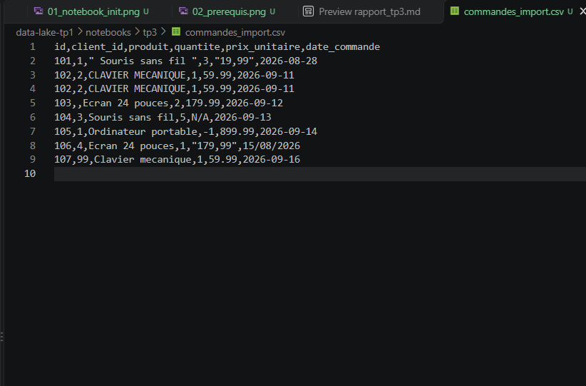

Le fichier est déposé dans `raw` sans aucune correction, comme une source à part entière. C'est le principe du Data Lake : garder d'abord ce qui est reçu tel quel, et nettoyer ensuite.

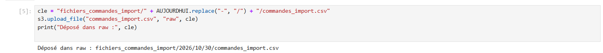

## Étape 3 - Profilage de la zone raw

Avant de nettoyer, j'ai regardé à quoi ressemble chaque source : nombre de lignes, colonnes, valeurs vides et doublons. Cela permet de savoir où sont les problèmes avant d'écrire les règles.

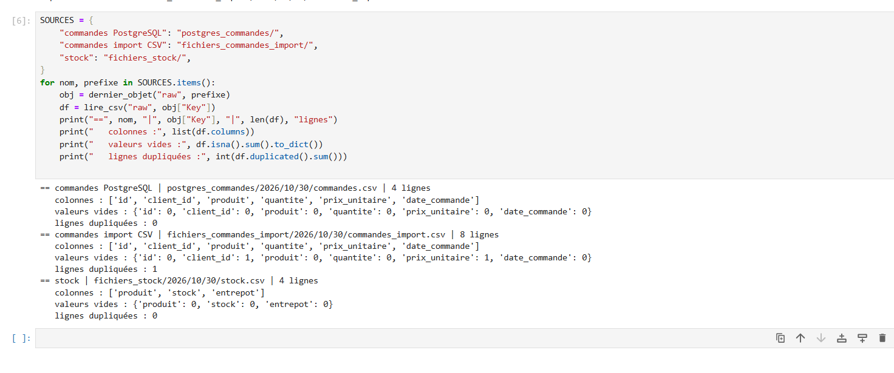

Les commandes PostgreSQL et le stock sont propres. L'export du partenaire a 2 valeurs vides et 1 doublon.

**1. Quelles anomalies ce profil détecte-t-il ?**
Il trouve le client manquant (103), le prix `N/A` (104), que pandas considère comme vide, et la ligne en double (102).

**2. Lesquelles lui échappent ?**
La virgule décimale, la quantité négative, la date `15/08/2026` et le client 99 ne sont pas vus. Le profil vérifie seulement si une valeur est présente, pas si elle est correcte. Pour les repérer, il faut vérifier le type et le sens des valeurs (un prix doit être un nombre positif, un client doit exister) : c'est l'objet des étapes 5 et 6.

**3. Pourquoi ne corrige-t-on rien dans raw ?**
Parce que `raw` doit rester la copie exacte de ce qui a été reçu. Si une règle de nettoyage se révèle fausse, il suffit de la corriger et de relancer le traitement depuis `raw`. Cela permet aussi de prouver au partenaire ce qu'il a réellement envoyé.

## Étape 4 - Trusted : clients et stock

J'ai commencé par les deux sources les plus simples. Dans `trusted`, les données sont enregistrées en Parquet : contrairement au CSV, ce format garde le type de chaque colonne (nombre, texte, date) et prend moins de place.

Les clients arrivent de l'API en JSON imbriqué. Il a fallu les mettre à plat avec `pd.json_normalize` (la ville, rangée dans `address`, devient une simple colonne), puis ne garder que les 5 colonnes utiles. L'email est mis en minuscules : sinon, deux écritures du même email seraient vues comme deux emails différents.

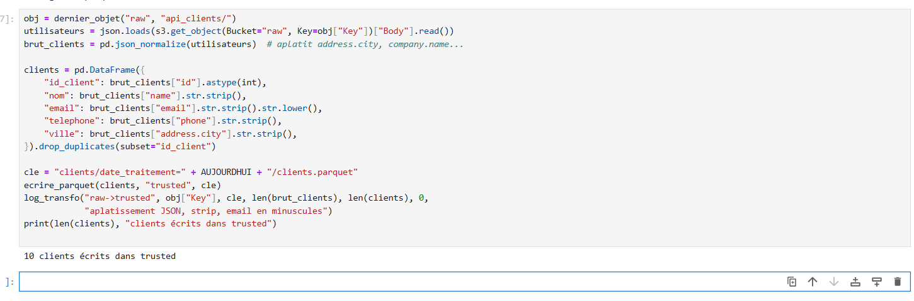

Le fichier est rangé dans `clients/date_traitement=2026-10-30/`. Chaque exécution crée un nouveau dossier daté au lieu d'écraser le précédent, ce qui conserve l'historique des traitements. Le stock suit le même principe, avec des noms de produits harmonisés et une colonne `stock` convertie en nombre.

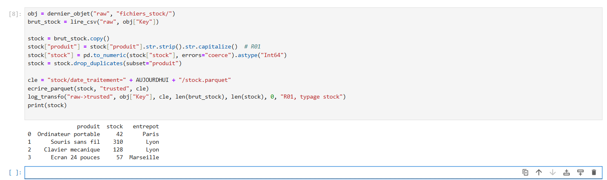

Les deux fichiers apparaissent bien dans le bucket `trusted` de MinIO :

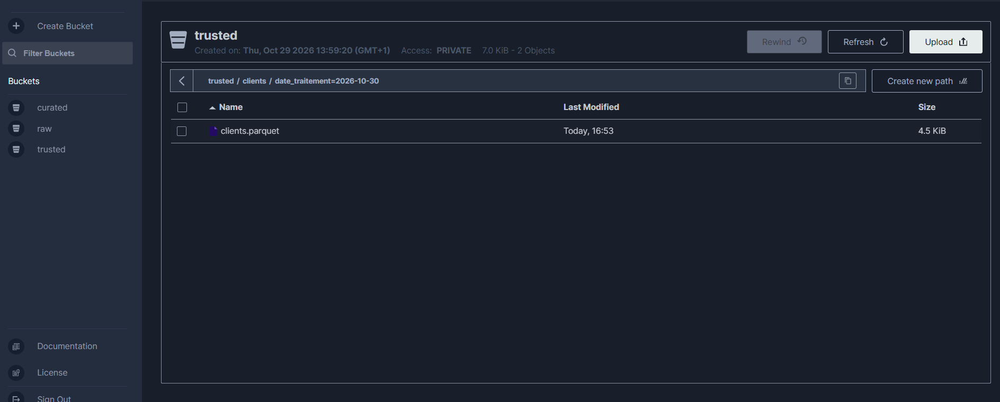

J'ai ajouté un contrôle sur les emails sans `@`. Il trouve 0 erreur, ce qui est normal ici. Son intérêt est de prévenir le jour où la source enverra des données mal formées.

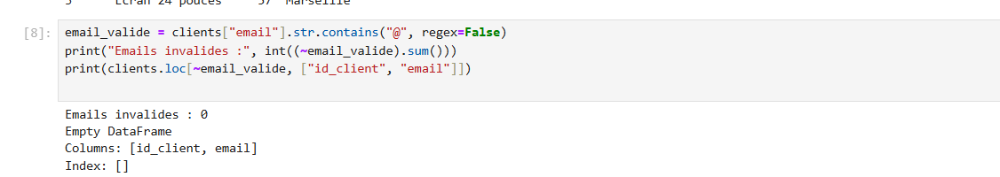

## Étape 5 - Trusted : nettoyage des commandes

Les commandes de PostgreSQL et celles du partenaire ont les mêmes colonnes. Elles sont donc réunies dans un seul tableau, pour leur appliquer les mêmes règles et n'avoir qu'une table de commandes dans `trusted`. Une colonne `source` garde l'origine de chaque ligne : si une ligne pose problème, il est facile de savoir d'où elle vient.

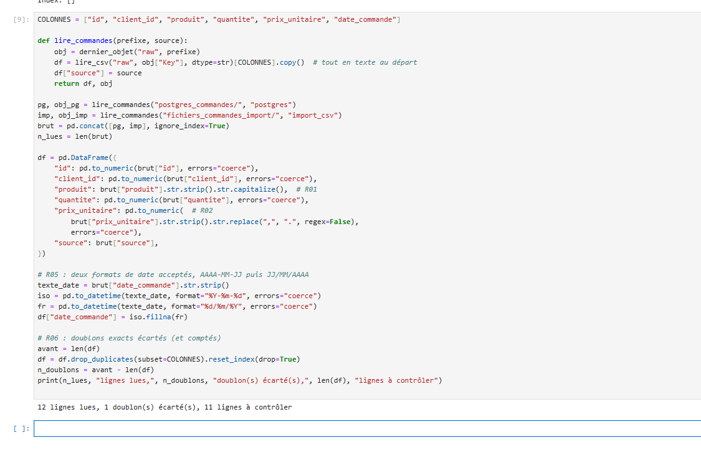

Les fichiers sont lus en texte, puis chaque colonne est convertie à part. Si pandas devinait les types, le seul `N/A` suffirait à transformer toute la colonne des prix en texte. Avec `errors="coerce"`, une valeur illisible devient simplement vide, sans faire planter le traitement, et peut être traitée ensuite.

Je n'ai corrigé que ce qui ne fait aucun doute : les espaces, les majuscules, la virgule décimale et la date au format français. Le sens de la donnée ne change pas, seule sa forme change. Le doublon de la commande 102 est supprimé, mais il est compté : le journal explique ainsi pourquoi 12 lignes lues n'en donnent que 11.

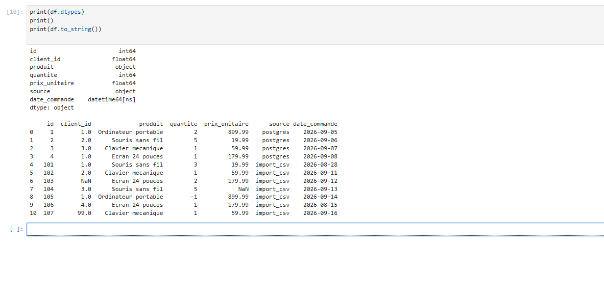

Toutes les colonnes ont maintenant un vrai type, `19,99` est devenu `19.99` et la date `15/08/2026` est bien lue. Le client vide (103) et le prix `N/A` (104) restent vides : il est impossible de deviner la bonne valeur, et en inventer une fausserait les chiffres. Ces lignes seront mises de côté à l'étape 6.

## Étape 6 - Contrôles qualité et quarantaine

Chaque commande est vérifiée par une série de règles. Si une ligne ne passe pas, elle reçoit un motif de rejet qui explique pourquoi : client manquant, prix invalide, quantité invalide, date invalide ou client inconnu. Seul le premier motif trouvé est gardé, pour que chaque ligne n'ait qu'une raison claire.

Un rapport qualité mesure ensuite les cinq critères vus en cours : complétude, validité, unicité, cohérence et fraîcheur. Chaque mesure est comparée à un seuil, puis marquée OK ou ALERTE.

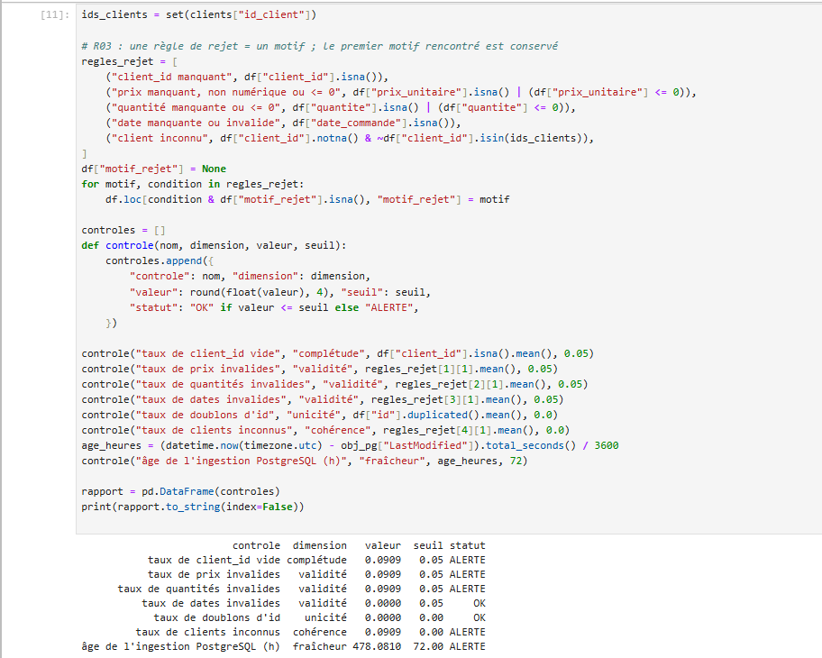

Les alertes sur le client vide, les prix, les quantités et les clients inconnus correspondent aux erreurs placées dans le fichier du partenaire : chacune touche 1 ligne sur 11 (9 %), au-dessus du seuil de 5 %. Les dates et les identifiants sont corrects.

La fraîcheur est aussi en ALERTE, alors que le sujet l'attend OK. Les commandes PostgreSQL ont été ingérées au TP 2, le 30/10, soit environ 478 heures avant la reprise du TP, alors que le seuil est fixé à 72 heures. Le contrôle fonctionne donc comme prévu : il signale que ces données sont trop anciennes et qu'il faudrait relancer l'ingestion.

Les lignes valides sont ensuite écrites dans `trusted/commandes/`, et les 4 lignes rejetées dans une zone de quarantaine, `trusted/_rejets/`. Le rapport qualité est enregistré à côté, dans `_qualite/`. Les lignes rejetées ne sont pas supprimées : elles restent disponibles pour être corrigées avec le partenaire.

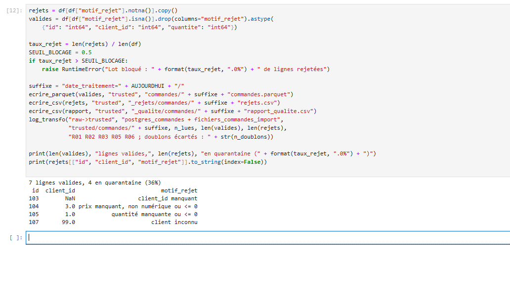

Le résultat donne 7 lignes valides et 4 en quarantaine (103, 104, 105 et 107), soit 36 % de rejets.

**1. Le rapport indique des alertes, pourtant le pipeline continue. Pourquoi ?**
La règle appliquée consiste à ne bloquer que si plus de la moitié des lignes est rejetée. En dessous, les mauvaises lignes sont mises de côté et les bonnes continuent. Pour les métiers, c'est plus utile de disposer des 7 commandes fiables tout de suite, avec la liste des 4 à corriger, que de tout bloquer à cause de quelques erreurs. En revanche, si la majorité d'un fichier est fausse, c'est le fichier entier qui est suspect (format changé, export raté) : là, il vaut mieux arrêter.

**2. Que se passe-t-il avec un seuil de blocage à 0.2 ?**
Avec 36 % de rejets, le seuil de 20 % est dépassé : le traitement s'arrête avec l'erreur « Lot bloqué » et rien n'est écrit dans `trusted`. J'ai ensuite remis le seuil à 0.5.

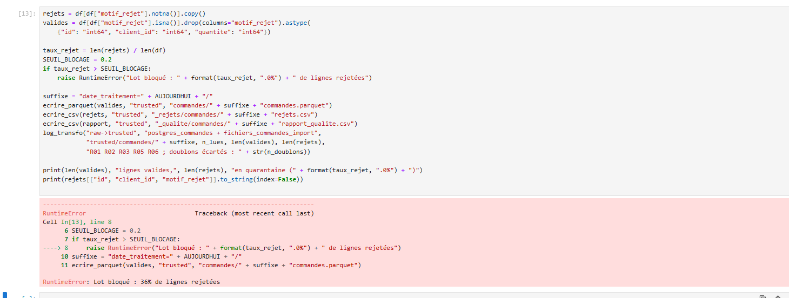

**3. Contrôle des quantités supérieures à 1000**
Les commandes de ce jeu de données portent sur 1 à 5 articles. Une quantité au-dessus de 1000 serait presque sûrement une erreur de saisie, par exemple un zéro en trop. J'ai donc fixé le seuil à 0 : une seule commande de ce type suffit à déclencher l'alerte et à la faire vérifier. Ici, aucune commande ne dépasse 1000, donc le contrôle est OK.

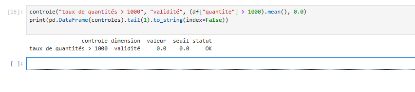

## Étape 7 - Curated : pseudonymisation, faits et partitions

La zone `curated` est celle que liront les analystes. Elle doit être pratique à interroger, et ne doit pas exposer de données personnelles.

Avant de protéger quoi que ce soit, il faut classer chaque colonne selon sa sensibilité. Le nom, l'email et le téléphone permettent d'identifier directement une personne : ils sont classés sensibles, et ce classement décide de ce qui ira ou non dans `curated`.

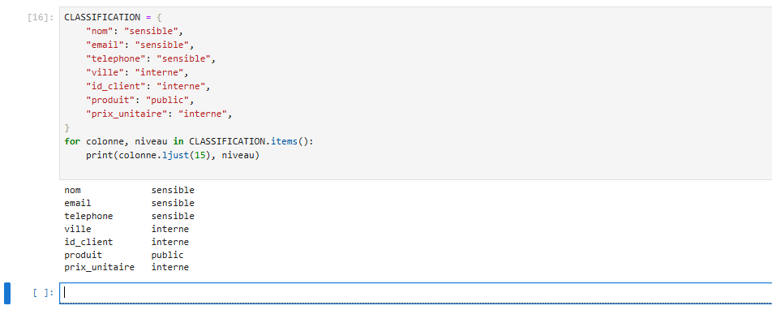

La dimension client ne garde donc que l'identifiant, la ville et un **pseudonyme** de l'email. Ce pseudonyme est une empreinte SHA-256 calculée avec un « sel » : le même email donne toujours le même code, ce qui permet encore de relier les tables, mais le code ne permet pas de retrouver l'email. Un `assert` vérifie qu'aucune colonne sensible n'est passée, et arrête le traitement si c'est le cas.

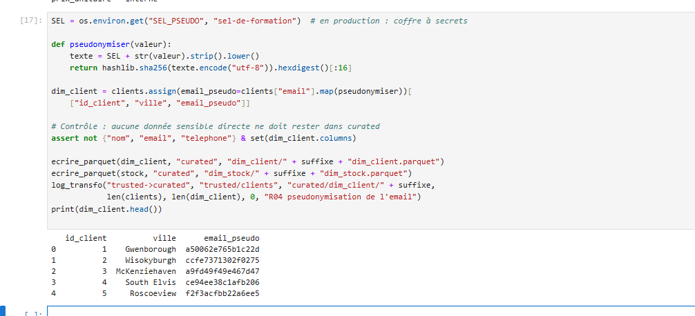

Cette protection a une limite : une donnée pseudonymisée reste une donnée personnelle au sens du RGPD, tant que le sel permet de refaire le calcul. Ici, le sel est écrit dans le code pour simplifier le TP ; en production, il serait rangé dans un coffre à secrets, jamais dans le dépôt Git.

Vient ensuite la **table de faits** `fait_ventes` : les commandes valides, enrichies de la ville du client et d'un montant (quantité × prix). Elle est découpée en un fichier Parquet par année et par mois. Une requête sur septembre n'aura ainsi à lire que le dossier `mois=09`. Un agrégat des ventes par produit est aussi préparé, pour répondre directement aux questions les plus courantes.

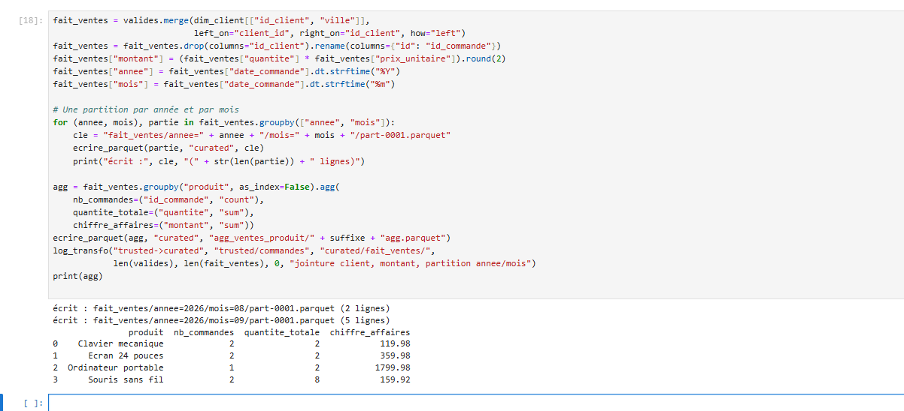

En relisant tous les fichiers de `fait_ventes`, je retrouve bien les 7 lignes valides, réparties sur 2 partitions (août et septembre), avec leurs types conservés par le Parquet :

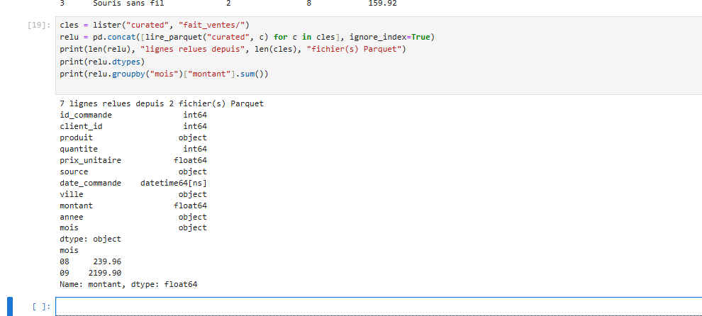

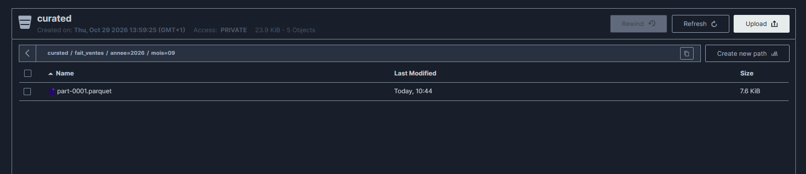

**Question métier : quel est le chiffre d'affaires par ville ?**
Gwenborough arrive très loin devant, avec 2 039,94 €, essentiellement grâce à une commande de 2 ordinateurs portables.

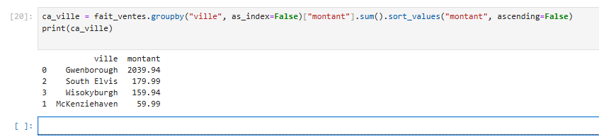

**Exercice : les fichiers de curated contiennent-ils une identité directe ?**
Non : aucun des 5 fichiers ne contient de nom, d'email ou de téléphone.

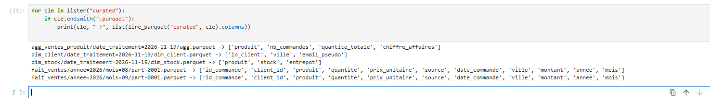

En revanche, la colonne **`ville`** permet de ré-identifier une personne si elle est combinée à d'autres. Dans ces données, chaque ville correspond à un seul client : connaître la ville d'une vente, c'est savoir qui l'a faite. La date et le produit précisent encore le profil. De plus, `client_id` est resté dans `fait_ventes` : il suffit de le croiser avec `trusted/clients` pour retrouver le nom. Une piste serait de remplacer la ville par une zone plus large (la région) et de pseudonymiser aussi l'identifiant client.

## Étape 8 - Droits d'accès MinIO

Jusqu'ici, tout le TP utilisait le compte administrateur de MinIO, qui a tous les droits. Un analyste n'a pourtant besoin que de lire `curated`. J'ai donc appliqué le principe du **moindre privilège** : chaque compte reçoit seulement les droits dont il a besoin. Si ses identifiants fuitent, les dégâts restent limités, et les données brutes de `raw` ou la quarantaine de `trusted` ne sont pas exposées.

Dans MinIO, ces droits sont décrits par une politique au format JSON. Celle-ci n'autorise que deux actions, et uniquement sur le bucket `curated` : lister son contenu et lire ses fichiers. Tout ce qui n'est pas autorisé est refusé par défaut.

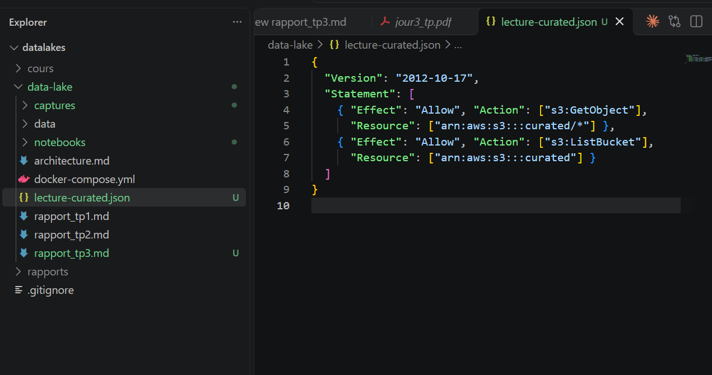

La politique est enregistrée dans MinIO, puis rattachée à un nouvel utilisateur, `analyste`, avec le client en ligne de commande `mc`. Le lien de téléchargement de `mc.exe` donné par le sujet ne fonctionne plus : MinIO a retiré ce fichier (le serveur répond « 410 Gone »). J'ai donc lancé les commandes du sujet avec le même client `mc`, exécuté dans un conteneur Docker (`cgr.dev/chainguard/minio-client`) via un raccourci PowerShell. Seul `.\mc.exe` devient `mc`, les commandes sont identiques.

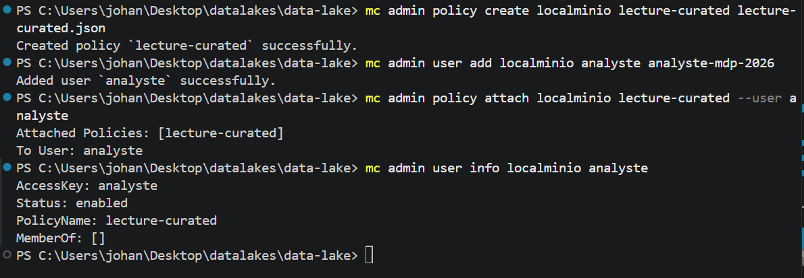

Pour vérifier, le notebook se connecte à MinIO avec le compte `analyste` et tente trois actions. La lecture de `curated` est autorisée, alors que la lecture de `raw` et l'écriture dans `curated` sont refusées (`AccessDenied`). L'analyste peut donc consulter les données préparées, sans voir les données brutes ni modifier ce qu'il lit.

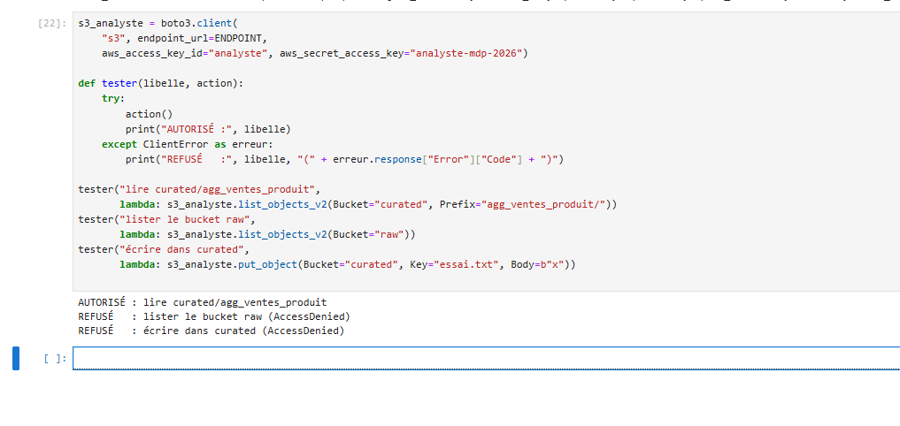

## Étape 9 - Performance : CSV contre Parquet

Depuis le début du TP, le Parquet est présenté comme meilleur que le CSV : cette étape sert à le vérifier par des mesures. Avec 7 commandes, aucune différence ne serait visible : il a fallu générer un jeu fictif de 500 000 commandes, avec un générateur aléatoire fixé (`seed 42`) pour que les données soient identiques à chaque exécution.

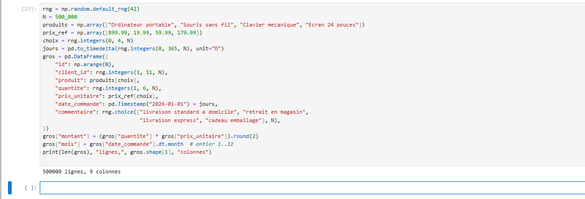

Le même tableau est ensuite écrit en CSV, en Parquet et en Parquet partitionné par mois. Pour chaque format, la taille, le temps d'écriture et le temps de lecture d'une seule colonne (`montant`) sont mesurés. Comme le conseille le sujet, j'ai lancé la cellule deux fois et gardé la seconde mesure : les fichiers sont alors en cache et les temps plus stables.

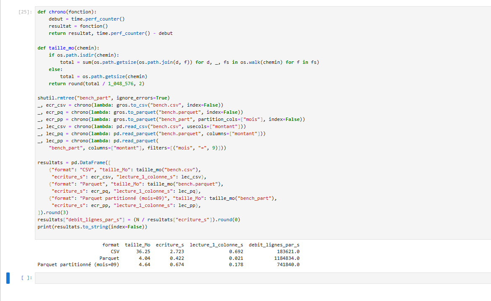

| Format | Taille (Mo) | Écriture (s) | Lecture 1 colonne (s) | Débit (lignes/s) |
|---|---|---|---|---|
| CSV | 36,25 | 2,723 | 0,692 | 183 621 |
| Parquet | 4,04 | 0,422 | 0,021 | 1 184 834 |
| Parquet partitionné (mois=09) | 4,64 | 0,674 | 0,178 | 741 840 |

Le Parquet est environ 9 fois plus petit que le CSV, 6 fois plus rapide à écrire et 33 fois plus rapide à lire sur une colonne. Le partitionné est un peu plus gros et plus lent que le Parquet simple. Avec un seul fichier de 4 Mo, ouvrir 12 dossiers coûte plus cher que ce que fait gagner la lecture d'un seul mois. Le partitionnement devient intéressant sur de gros volumes, quand chaque partition pèse elle-même plusieurs centaines de Mo.

Le même test à travers MinIO mesure le temps de transfert vers le stockage objet :

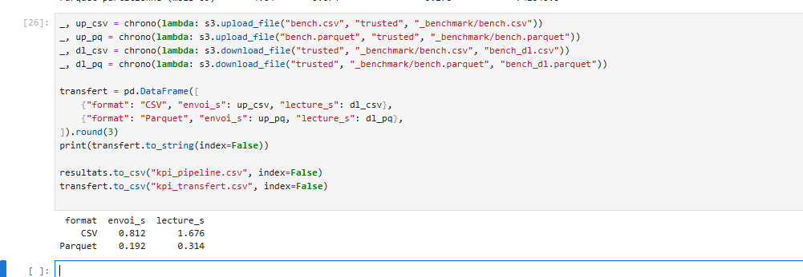

L'envoi est environ 4 fois plus rapide en Parquet et la lecture 5 fois plus rapide : le fichier est 9 fois plus petit, donc il y a beaucoup moins de données à faire passer sur le réseau. Les résultats sont enregistrés dans `kpi_pipeline.csv` et `kpi_transfert.csv`.

Enfin, les trois algorithmes de compression du Parquet sont comparés :

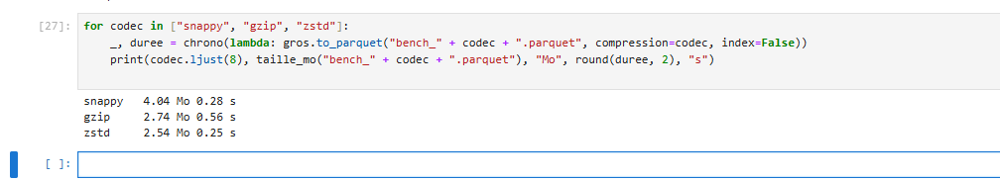

**1. Quel format est le plus petit, et pourquoi ?**
Le Parquet. Il range les données par colonne : les valeurs d'une même colonne se ressemblent (4 produits, 4 commentaires possibles), ce qui se compresse très bien. Il stocke aussi les nombres et les dates en binaire, alors que le CSV les écrit en texte, caractère par caractère, en répétant les mêmes libellés sur chaque ligne.

**2. Pourquoi la lecture d'une colonne est-elle beaucoup plus rapide en Parquet ?**
En CSV, pour récupérer la colonne `montant`, il faut quand même lire et découper chaque ligne en entier. En Parquet, chaque colonne est stockée à part : le moteur va directement lire `montant` et ignore les 8 autres colonnes.

**3. Que lit le moteur dans le cas du Parquet partitionné ?**
Avec le filtre `mois = 9`, il ne lit que le dossier `mois=9` et ignore les 11 autres mois sans même les ouvrir. Dans ce dossier, il ne lit que la colonne `montant`.

**4. Quels indicateurs ont été mesurés, lesquels manquent ?**
Les mesures couvrent la **latence** (temps d'une écriture ou d'une lecture), le **débit** (lignes écrites par seconde), le **temps de transfert** (envoi vers MinIO et lecture depuis MinIO) et l'espace occupé, qui renseigne sur la **capacité** de stockage nécessaire. Il manque le comportement quand plusieurs utilisateurs lisent en même temps, la consommation de mémoire et de processeur, et l'évolution des temps quand le volume augmente, puisqu'une seule taille a été testée.

**5. Quel compromis entre snappy, gzip et zstd ?**
Snappy, le codec par défaut, est rapide mais compresse le moins (4,04 Mo). Gzip réduit la taille (2,74 Mo) mais met deux fois plus de temps à écrire. Zstd donne ici le meilleur des deux : le fichier le plus petit (2,54 Mo) et le temps d'écriture le plus court (0,25 s). Sur ma machine, zstd est donc le meilleur choix.

Les fichiers de test, qui étaient volumineux, ont été supprimés du dossier de travail une fois les mesures faites.

## Étape 10 - Journal, documentation et versionnement

Chaque transformation du TP a ajouté une ligne au journal. Il est enregistré dans `notebooks/tp3/journal_transformation.csv` et dans `trusted/_journal/`, pour qu'il reste disponible à côté des données qu'il décrit.

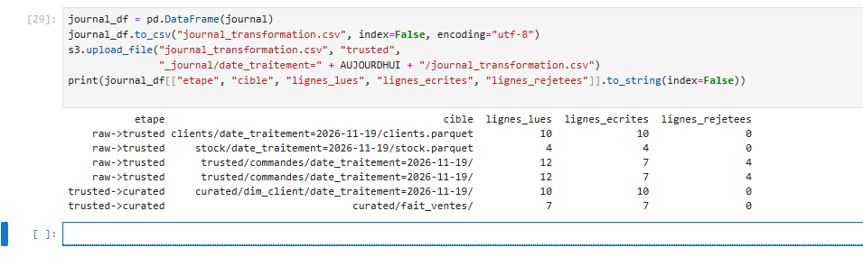

Le journal permet de suivre chaque ligne de bout en bout. Sur les 12 commandes lues, 7 sont valides, 4 sont en quarantaine et 1 doublon a été écarté. Les 7 commandes valides se retrouvent ensuite dans `fait_ventes`. La ligne des commandes apparaît deux fois, parce que j'ai relancé la cellule après le test du seuil de blocage (étape 6) : le journal garde une trace de chaque exécution réelle, même répétée.

Les règles R01 à R06 sont documentées dans `notebooks/tp3/regles_transformation.md`, avec pour chacune l'étape concernée et sa justification. Ce fichier est versionné avec le code : si une règle change, l'historique Git montre quand et pourquoi.

Le sujet demande enfin de versionner le projet en excluant les données et le client `mc`. Le `git init` n'a pas été nécessaire : le projet est sous Git depuis le TP 1, sur le dépôt GitHub indiqué en tête de rapport, et son `.gitignore` excluait déjà `mc.exe` et les fichiers temporaires de Jupyter.

En le comparant au sujet, j'ai toutefois constaté un écart : le `.gitignore` n'excluait que le stockage de MinIO et de PostgreSQL (`data/minio/`, `data/postgres/`), si bien que les fichiers sources des TP 1 et 2 (`ventes.csv`, `clients.json`, `commandes.sql`) étaient encore dans le dépôt. Pour respecter la consigne, le `.gitignore` exclut maintenant tout le dossier `data/`, et j'ai retiré ces trois fichiers du suivi avec `git rm -r --cached data-lake/data`. Cette commande les retire de Git sans les supprimer du disque : la stack Docker fonctionne toujours, et une copie de chaque fichier reste dans `notebooks/tp1/` et `notebooks/tp2/`, là où les notebooks les lisent.

Le code, le notebook, les règles, le journal et les mesures du TP 3 sont ensuite ajoutés au dépôt dans un commit dédié.

## Conclusion

Les données passent maintenant par les trois zones du Data Lake. `raw` garde ce qui a été reçu, sans y toucher. `trusted` contient des données nettoyées, typées et contrôlées, tandis que les lignes douteuses sont mises en quarantaine au lieu d'être corrigées au hasard. `curated` propose des tables prêtes pour l'analyse, sans identité directe, et accessibles en lecture seule à un analyste.

Ce TP montre surtout que chaque choix se vérifie : le rapport qualité mesure les erreurs, le journal explique chaque écart de lignes, le test d'accès prouve les droits et les mesures confirment l'intérêt du Parquet. Il en ressort aussi deux limites : le sel de pseudonymisation est écrit dans le code, et la colonne `ville` permet encore de reconnaître un client dans un si petit jeu de données.
